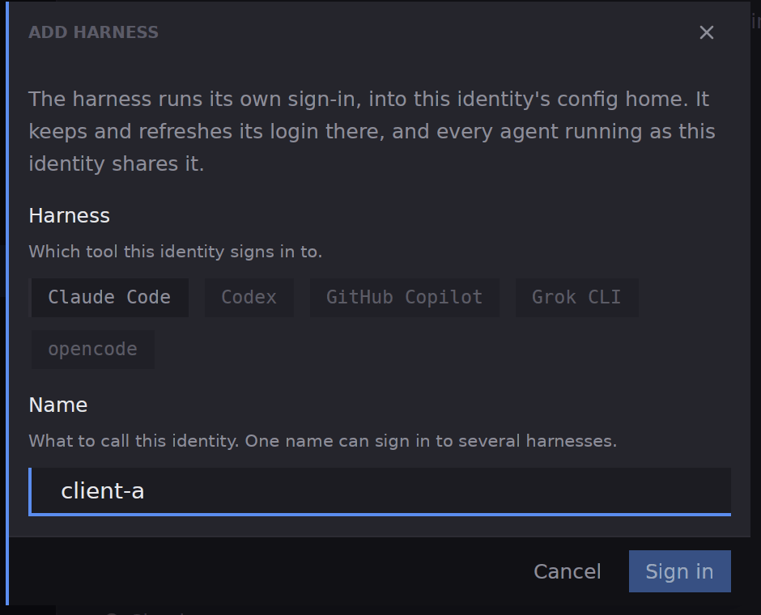
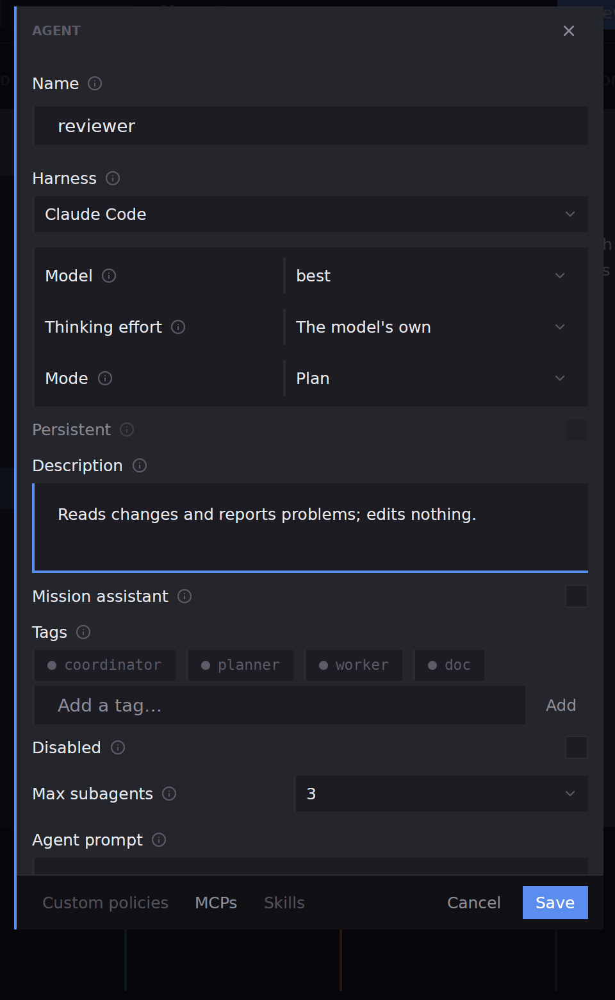
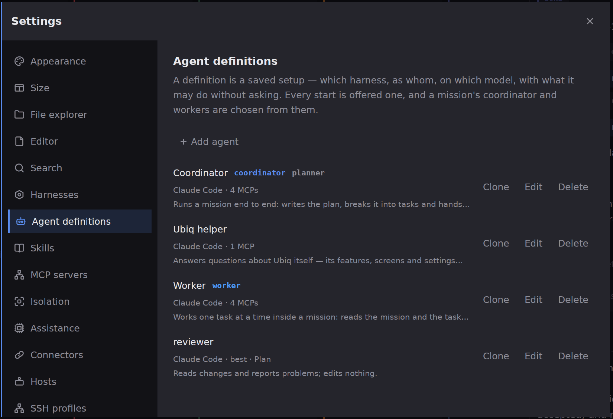
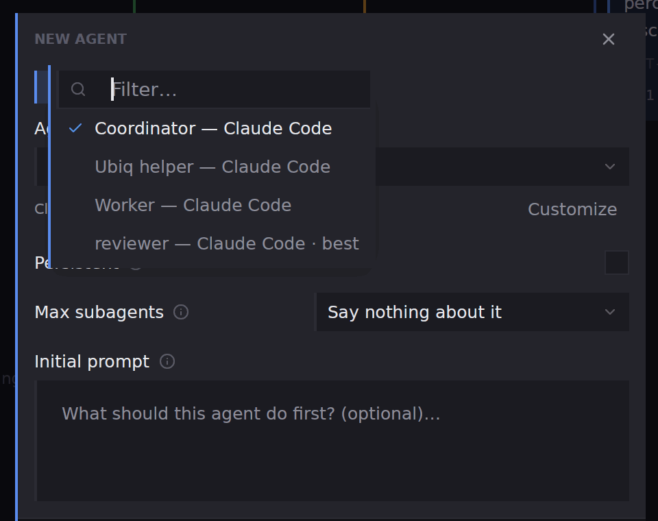

## What you will end up with

One account per client, each signed in once, and a saved agent definition for each role you repeat, so a new agent starts as the right identity with one pick.

## Before you start

The harness you work with is installed. You know the logins you will use, one per client. An account is an identity a harness runs under; a definition is the saved setup a run starts from. [Accounts and agent definitions](concepts-accounts-and-definitions) explains why they are separate.

## Steps

1. Open **Settings** in the [title bar](workbench-titlebar) and pick **Harnesses**. **Installed** lists every harness Ubiq knows, dimmed where it is not on this machine. **Identities**, further down, lists your accounts.
2. Under **Identities** press **Add harness**. Pick the harness, then give the identity a **Name** that tells clients apart, such as `client-a`, and press **Sign in**. The harness runs its own sign-in inside the dialog, the same screen it shows in a shell; Ubiq never holds the password or token. An address the sign-in prints appears as a button under the terminal.

3. Repeat for the next client with another name. One name can sign in to several harnesses, and every agent running as that name shares the login. Under each account, a harness row shows its login status with **Check**, **Re-authenticate** and **Sign out**, and a plan readout where the provider states limits.
4. Open **Agent definitions** in Settings and press **Add agent**. Type a **Name** for the role, such as `reviewer`, pick the **Harness**, and set **Model**, **Thinking effort** and **Mode**. Where an account is signed in, the **Harness** row offers the harness under each account, so the definition pins the client as well as the role. Add a **Description** so you remember what it is for.

5. Press **Save**. The definition joins the list as `name`, then its harness, model and mode. **Clone** copies one under a new name, which is the quickest way to make the same role for another client; **Edit** and **Delete** do what they say.

6. Start from a definition. Press **New agent**, stay on the **Agents** tab and open the **Agent** row: every saved definition is listed, each as `name — harness`. Pick one, write the first request, and press **Start**. **Customize** under the row changes the model, level or mode for this one start without touching the definition.

7. To offer different definitions in one client's project, open that project's settings and pick **Agent definitions**. A definition saved in a project beats a global one of the same name, in that project only.

## What next

- [Accounts](agents-accounts), for re-authenticating, signing out and what **Check** reports.
- [Agent definitions](agents-definitions), for badges, **Off** and renaming.
- [Switch a harness's permission mode](how-to-switch-permission-mode), to pin a mode in a definition.
