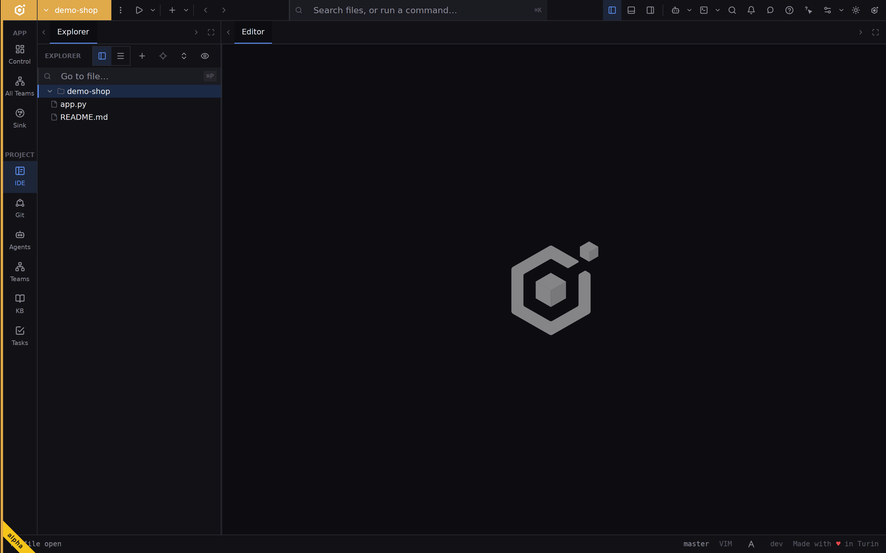
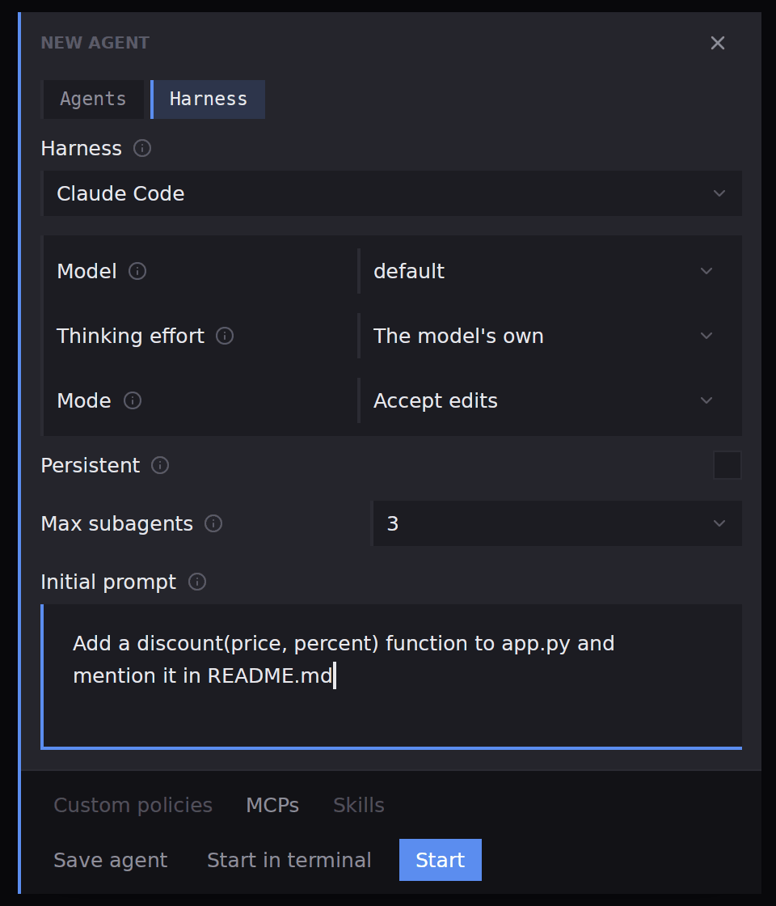
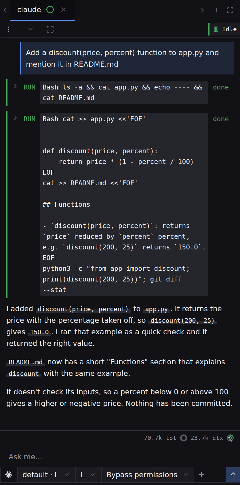

## What you will end up with

A folder open as a project, and one agent working in it from a first request you wrote, with its answer beside your files.

## Before you start

One harness installed on your machine, such as Claude Code, and signed in the way that harness asks. A folder you can afford to let an agent edit; a small git repository is ideal, because [Review and commit](guides-review-and-commit) picks up where this guide stops.

## Steps

1. Open the folder as a project. On a fresh window press **Add a project…** in the middle of the editor; later, use **Add a project** in the [title bar](workbench-titlebar). Pick the folder in the chooser. The title bar shows the project's name, the rail lights up, and the explorer lists the folder's files.

2. Press **New agent** in the title bar. The **New agent** dialog opens. Everything under the first row stays faint until you choose what to run.
3. Open the **Harness** tab, press the **Harness** row and pick the harness you want. A dimmed name is a harness that is not on this machine; [Settings](settings-harnesses) says how to point Ubiq at it.
4. Leave **Model** and **Thinking effort** alone for now, and pick a **Mode**. A permission mode is how much the agent may do before asking you; each harness uses its own names, and [Permission modes](agents-permissions) explains them.
5. Write the first request in **Initial prompt**, for example `Add a discount(price, percent) function to app.py and mention it in README.md`. Ubiq sends it as the agent's first message, so the agent starts without another keystroke.

6. Press **Start**. A chat tab named for the harness opens on the right, and the agent begins. It reads your files, runs commands and edits, each as a card in the transcript. When it needs an answer from you, a prompt appears on the call it concerns; answer it with its buttons.

7. When the transcript settles on **Idle**, look at the explorer: files the agent edited carry **M** and new ones **U**, in the colour of their state. Type a follow-up in **Ask me…** to keep going, or move on to [Review and commit](guides-review-and-commit) to read the changes.

To see the harness's own screen instead of the chat view, press **Start in terminal** in step 6. That runs the same harness as a terminal [pane](panes), and it ignores the initial prompt.

## What next

- [Review and commit what an agent changed](guides-review-and-commit), to read and keep the edits.
- [Two agents on one task, side by side](guides-two-agents-side-by-side), to compare a second agent with the first.
- [Starting an agent](agents-starting) and [the new agent dialog](agents-new-agent), for every choice the form offers.
