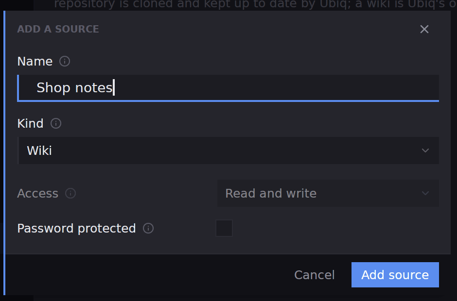
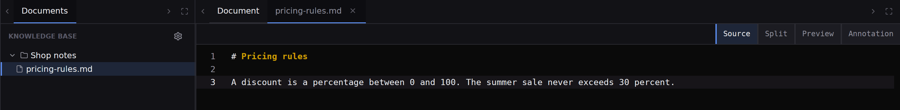

## What you will end up with

A source of documents attached to your project, one document written in it, and an agent that has been pointed at that document to answer from it.

## Before you start

A project is open. The steps below create a *wiki*, a source Ubiq keeps for the project and that starts empty, so there is nothing to prepare. If your notes already live in a folder or a git repository, the same form attaches them; step 2 says where.

## Steps

1. Open the project's settings with the three-dot **Project settings** button beside the project's name in the [title bar](workbench-titlebar), and pick **Knowledge base** in the list. It reads `No sources configured` until you add one. Press **Add source**.
2. Fill in the form. Type a **Name**, such as `Shop notes`, and pick the **Kind**: **Folder** reads a folder where it lies, **Git repository** is cloned and kept by Ubiq, and **Wiki** is Ubiq's own and always writable. Choose **Wiki**, then press **Add source** in the form and **Save changes** at the foot of the settings.

3. Pick **KB** on the rail. The **Documents** panel lists the source by name. [Knowledge base sources](kb-sources) covers the folder and repository kinds, the filter beside each source and passwords for a wiki.
4. Right-click the source and pick **New file**. Type a name ending in `.md`, such as `pricing-rules.md`, and press **Create**. The file appears under the source.
5. Click the file. It opens in its own tab with **Source**, **Split**, **Preview** and **Annotation** across the top. Pick **Source**, click in the text and write: a heading, then the rules or facts you want an agent to respect. A dot on the tab means unsaved edits. Press **⌘S** / **Ctrl+S** to save, and the dot goes.

6. Right-click the file in **Documents** and pick **Copy path**. Press **New agent** in the title bar, choose a harness, and write a request in **Initial prompt** that names the document and pastes the path, for example: `Read the pricing rules at <path> and tell me whether discount() in app.py follows them.` Press **Start**.
7. Keep the document open beside the agent. The agents Ubiq starts for the project can write to the same documents, so a note the agent saves shows up in **Documents** and in your tab, and an edit you save is what the next agent reads. [Panels](workbench-panels) shows how to put the document and the chat side by side.

## What next

- [Knowledge base sources](kb-sources), to attach a folder of notes or a documentation repository.
- [Reading a document](kb-documents), for pinning tabs and the other tab menu entries.
- [The knowledge base](kb-overview), for the tree's right-click menu and a source's states.
