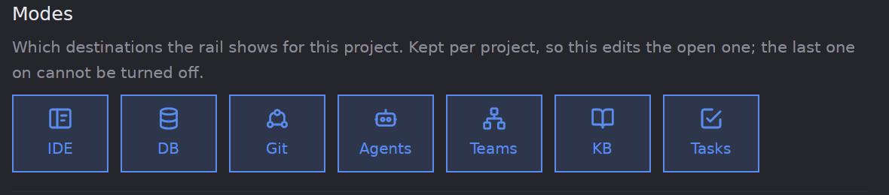
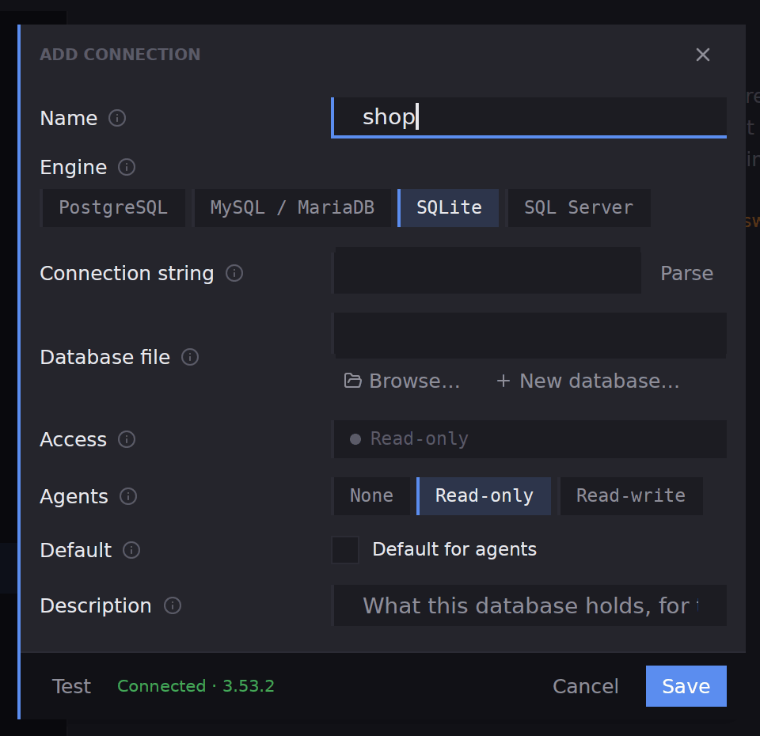
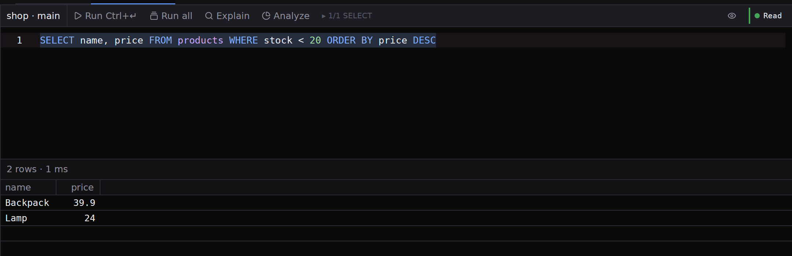

## What you will end up with

A database connection saved with the project, a query run against it, and an agent in a chat tab beside the editor, helping you read or rewrite that query.

## Before you start

A project is open and you have a database to look at: PostgreSQL, MySQL or MariaDB, SQLite or SQL Server. The steps use a SQLite file, which needs no server or password. A server needs its host, port, database and user, and a password that Ubiq asks for when you connect.

## Steps

1. Turn **DB** on. It is off until a project asks for it. Open the project's settings with the three-dot **Project settings** button beside the project's name, stay on **General**, and click the **DB** tile under **Modes**. Press **Save changes**. **DB** appears on the rail after **IDE**.

2. Pick **DB** on the rail and press **Add connection** in the **Databases** panel; it opens the project's settings on **Databases**, where you press **Add connection** again. Pick the **Engine**. For SQLite, press **Browse…** to choose the file, or **New database…** to make an empty one. To fill the form from an address, paste a connection string into **Connection string** and press **Parse**.
3. Give the connection a **Name**, such as `shop`, and press **Test**. It connects without saving and reports `Connected` with the server's version. Leave access on **Read-only** for a first look, so every tab on the connection refuses writes. Press **Save**, then **Save changes**.

4. Back in the **Databases** panel, right-click the connection and pick **Connect**. Open it down through the database to **Tables**, and double-click a table to read its data in the centre. A **Read-only** mark shows on the tab, and a count of rows under the filters.
5. Right-click the table and pick **Open in SQL editor**. A tab opens with a starting query. Click in it, select the text and write your own, for example `SELECT name, price FROM products WHERE stock < 20 ORDER BY price DESC`. Press **Run**, or **⌘↵** / **Ctrl+↵**, to run the selection or the statement the cursor is in. The rows appear under the editor with their count and the time taken.

6. Bring in the agent. Press **New agent** in the title bar, choose a harness, and write a request that carries what the agent needs, such as the table's columns and your query: `Explain this query and suggest an index for it: <query>`. A chat tab opens on the right, beside the editor. Paste what it suggests into the editor and press **Run** again; **Explain** shows the plan before you do.

Ubiq checks every statement before sending it. On a read-only tab it underlines one that would write and refuses it, and a statement that can change data asks first, with **Run anyway** to go ahead.

## What next

- [Databases](db-overview), for editing cells, **Apply**, the form view and the other engines.
- [Project settings](settings-project), for the **Databases** list with **Test**, **Edit** and **Remove**.
- [The knowledge base](kb-overview), to keep the schema's notes in a document the agent can open.
