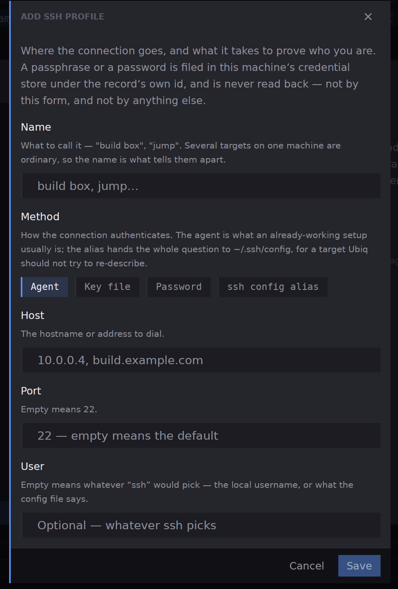
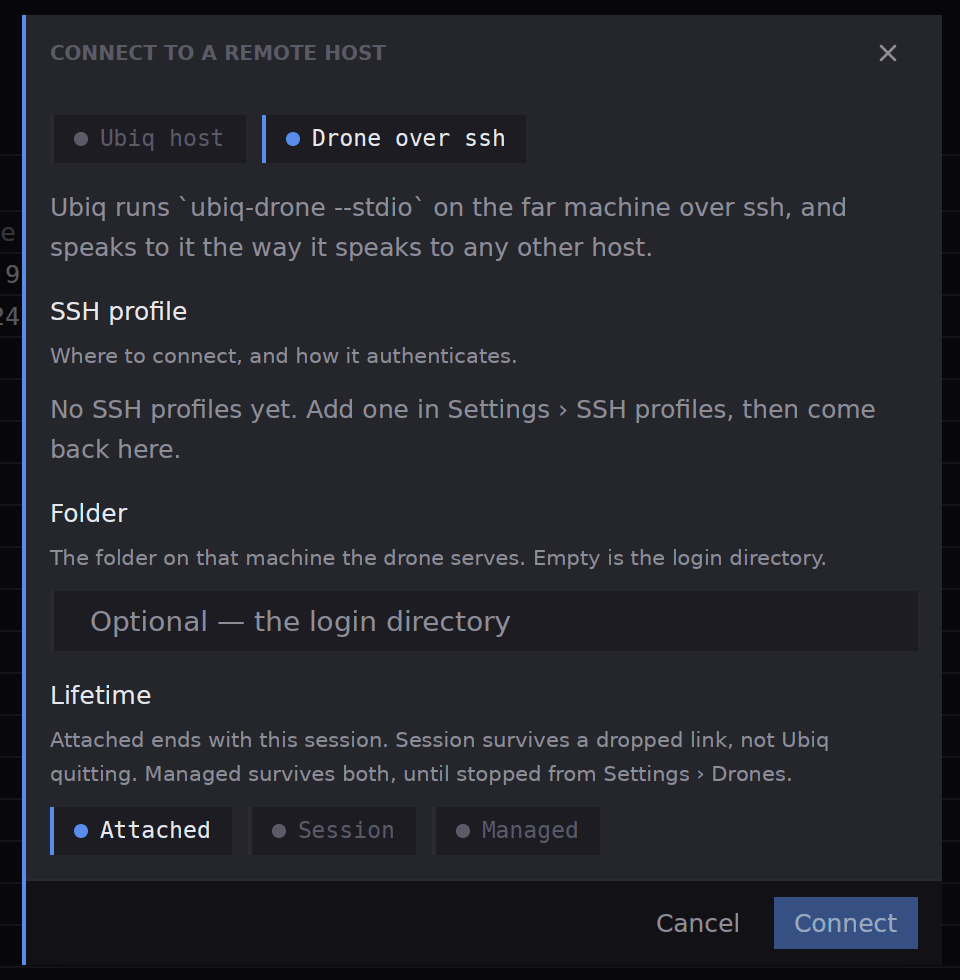

## What you will end up with

A folder on another machine open as a project in your window, with an agent and a shell running there, on that machine's files.

## Before you start

You can sign in to the machine with SSH, from this machine, with a key, an agent, a password or an entry in your SSH config. You know the folder you want to work in, spelt the way that machine spells it. Nothing needs installing by hand: Ubiq uploads its helper, a *drone*, the first time if the machine has none.

## Steps

1. Tell Ubiq how to reach the machine. Open **Settings** in the [title bar](workbench-titlebar), pick **SSH profiles**, and press **Add profile…**. Give it a **Name** such as `build box`, pick a **Method** (**Agent**, **Key file**, **Password** or **ssh config alias**), and fill in **Host**, **Port** and **User**. A port left empty means 22. Press **Save**.

2. Open the **More** chevron beside the **Settings** button in the title bar and pick **Connect to a remote host**. At the top of the dialog choose **Drone over ssh**.

3. Pick your profile under **SSH profile**; **Check** beside it tries the profile without connecting. Type the **Folder** the drone serves, or leave it empty for the login directory. Choose a **Lifetime**: **Attached** ends with this connection, **Session** survives a dropped link but not Ubiq quitting, and **Managed** survives both until you stop it under **Settings**, then **Drones**.
4. Press **Connect**. The host is listed in **Remote hosts**, which you open from the same chevron, with the chip **attached**. A host that drops shows **reconnecting**; **Reconnect now** retries at once.
5. Open the folder as a project. In the title bar, open the chevron beside **Add a project**, pick **Open a project on** and the host's name, and choose the folder. The project sits beside your local ones, and its files, search and terminals come from that machine. [The title bar](workbench-titlebar) has the details.
6. Start work there. **New agent** and **New terminal** now run on the remote machine, in the project's folder; the agent's chat tab and the terminal look the same as local ones. The steps of [Your first project and your first agent](guides-first-project-and-agent) apply unchanged.
7. When you finish, press **Disconnect** on the host's row in **Remote hosts**. That ends every pane the host was running. A drone left on **Session** or **Managed** can be listed and stopped under **Settings**, then **Drones**, with **Stop**, which asks first because its panes end with it.

For a machine already running Ubiq's own server, choose **Ubiq host** in step 2 instead, and paste the address and token the server printed.

## What next

- [Connecting to a host](remote-connect), for the **Ubiq host** form, https and certificates.
- [Hosts, SSH and drones](settings-hosts), for saved hosts, SSH secrets and stopping drones.
- [Remote hosts](remote-overview), for the chips and what each button does.
