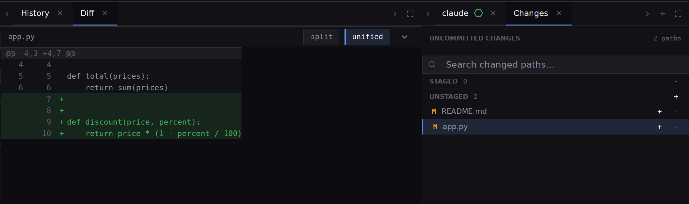
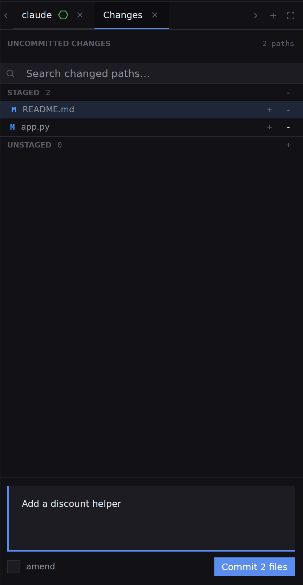
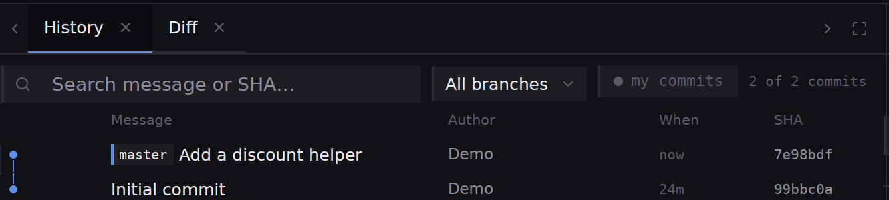

## What you will end up with

One commit holding the changes you accepted, with the rest left unstaged or thrown away.

## Before you start

An agent has changed files in a project that is a git repository. [Your first project and your first agent](guides-first-project-and-agent) produces such a change.

## Steps

1. Pick **Git** on the rail. **Branches** is on the left, **History** in the centre and **Changes** on the right. The top row of the history reads **Uncommitted changes** with a count, and the status line above says how many paths changed.
2. In **Changes**, look under **Unstaged**: one row per changed path, each with a letter, **M** for modified, **A** added, **D** deleted, **U** untracked. Click a row. **Diff** opens beside **History** and shows what that path changed.

3. Choose how you read it. **unified** draws one column, removed lines then added lines, which suits added blocks. **split** draws old and new side by side, which suits edits to a line. Click each path in turn.
4. Decide path by path. Press **+** on a row to stage it, so it goes into the next commit. Press **-** on a staged row to take it out again. The **+** on the **Unstaged** heading stages every path at once. Staging works per path, not per part of a file; [Stage a file](how-to-stage-a-file) has the detail.
5. To throw a change away, right-click its row and pick **Discard**. Ubiq asks first, because a change that is not committed is in no commit to get back.
6. Write the commit message in the box under the lists: a subject, a blank line, then a body if you want one. **Commit** reads `Commit 2 files` for the count you staged, and is dimmed until there is a message and at least one staged path.

7. Press **Commit**. The lists empty, the box clears, and the history gains a row at the top with the branch label and your subject.

8. If you committed too early, press **Undo last commit** in the strip across the top of Git mode. It takes the commit back into the staged list; it is refused on a first commit.

## What next

- [The Changes panel](git-changes), for amending a commit and for the right-click menu.
- [The Git screen](git-overview), for branches, pull and push.
- [Comparing two commits](git-compare-commits), when you want to see what a whole stretch of agent work added.
