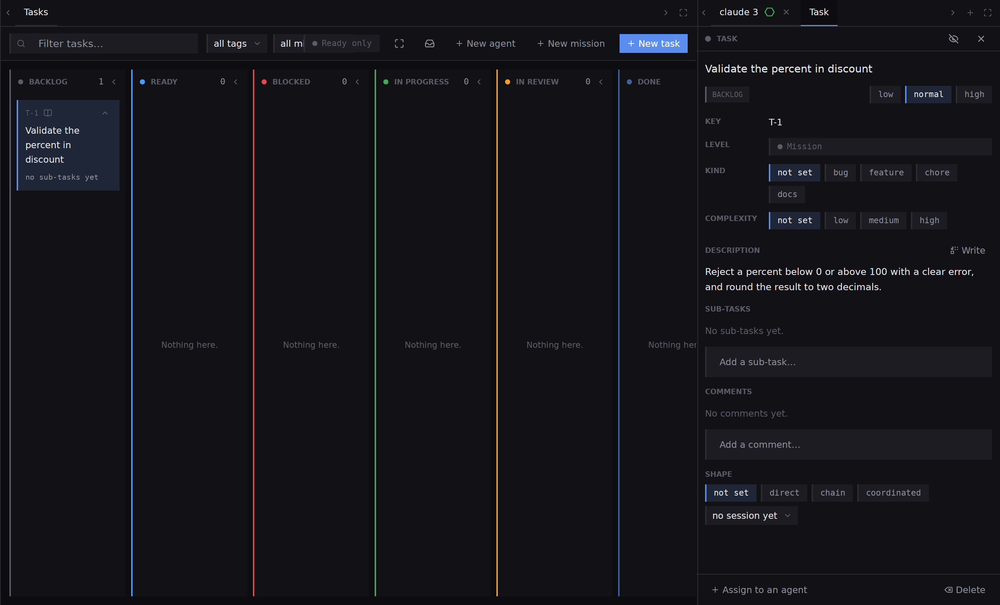
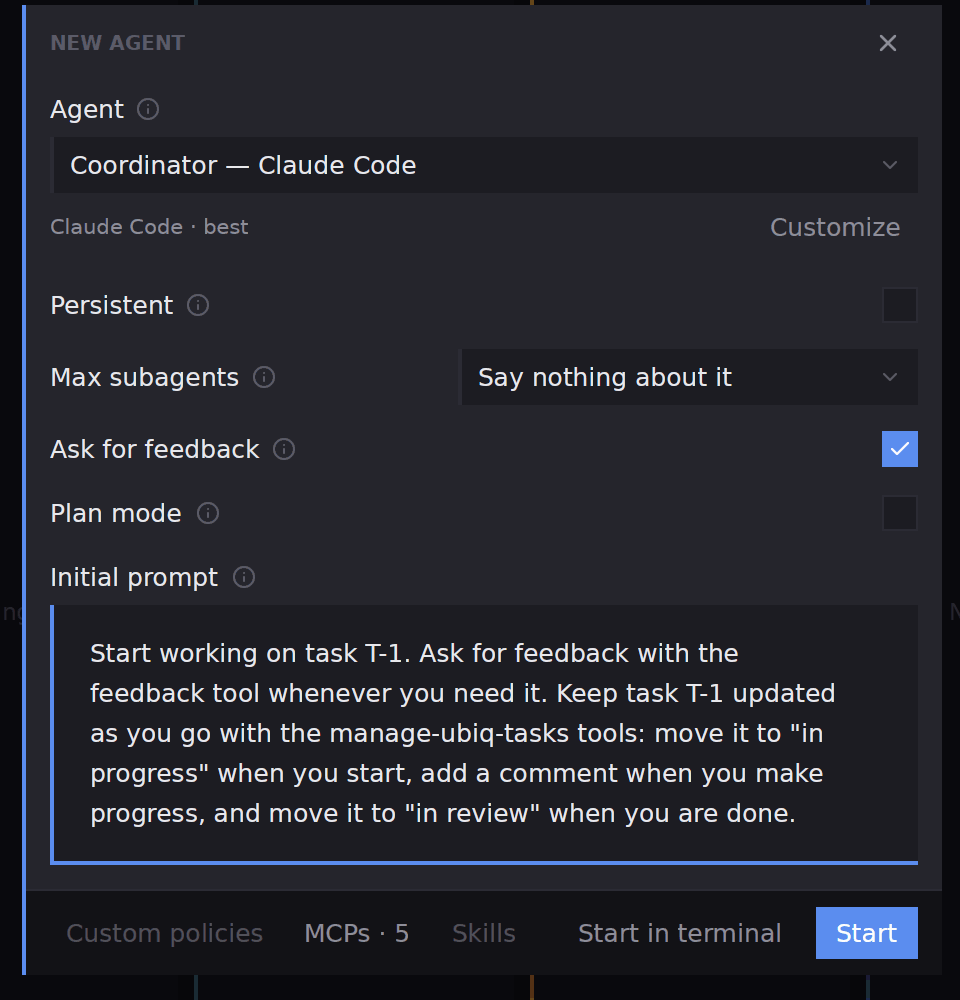
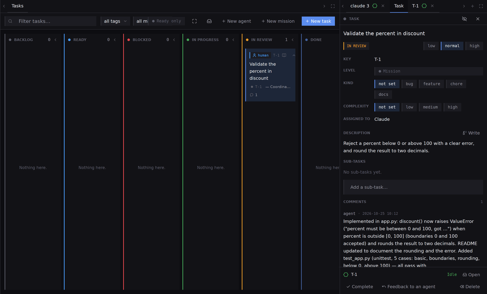

## What you will end up with

A task written as a card, handed to an agent that works it and reports back on the card, and accepted by you into **Done**.

## Before you start

A project is open, and one harness works for you. The repository can be any folder; for a git repository, [Review and commit](guides-review-and-commit) is the next stop after the agent finishes.

## Steps

1. Pick **Tasks** on the rail. The board is a row of columns, one per stage: **Backlog**, **Ready**, **Blocked**, **In progress**, **In review**, **Done**, each with a count. The right panel reads **No task open** until you select a card.
2. Press **New task**. Type a **Title**, such as `Validate the percent in discount`, and a **Description** in Markdown that says what finished looks like. Press **Create**. The card appears in **Backlog** with a key, `T-1`, and the right panel reports it whole.

3. Drag the card from **Backlog** to **Ready** to say it can be picked up. The stage tag in the panel changes with it; the stage changes only by moving the card.
4. With the card selected, press **Assign to an agent** at the foot of the panel. The **New agent** dialog opens with a prompt already written that names the task and asks the agent to keep it updated. Pick the agent setup in the **Agent** row, leave **Ask for feedback** ticked if you want the agent to ask you when stuck, and press **Start**.

5. Watch the board. The agent starts as a chat tab with the task's key beside the board, and the card follows its work: the agent moves it into **In progress**, adds a comment when it has made progress, and moves it to **In review** when it is done.
6. Select the card and read the panel. The comment says what changed, **Assigned to** names the agent, and **Open** next to the agent opens its conversation. Look at the changed files in **Git** as the [review guide](guides-review-and-commit) shows.

7. Accept or send back. **Complete** moves the card to **Done**. **Feedback to an agent** sends your remarks to an agent. Both appear only while the card is in review.
8. When a batch of cards is finished, the archive button in the board's toolbar files every done and abandoned task away at once. Archived tasks leave the board and cannot be brought back from it.

## What next

- [The Tasks board](tasks-overview), for filters, labels, missions and what the toolbar does.
- [A task](tasks-detail), for sub-tasks, prerequisites, comments and the shape of the agents on a task.
- [The Teams screen](teams-overview), to see the agents arranged by task.
