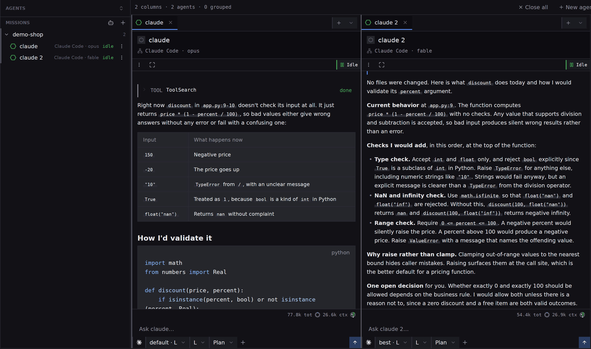

## What you will end up with

Two agents answering the same request in two columns next to each other, so you can read both and keep the better one.

## Before you start

A project is open and one harness works for you; [Your first project and your first agent](guides-first-project-and-agent) covers both. Both agents run in the same folder, so give them a task that only reads, or choose **Plan** as the mode for both. Two agents that edit the same files would write over each other.

## Steps

1. Pick **Agents** on the rail. With no agent on screen the centre says **No columns**, and the strip over it counts `0 columns`.
2. Press **New agent** at the right of that strip and pick **New agent** from its menu. In the dialog choose the harness, set **Mode** to **Plan**, and write the request in **Initial prompt**, for example `Read app.py and describe how you would validate the percent argument of discount. Do not change any files.` Press **Start**. A column opens with the agent in it.
3. Press **New agent** again. The dialog opens on your last choice, so the harness, mode and wording are ready. Change what you want to compare: pick another entry in the **Model** row, or another harness. Paste the same request, then press **Start**. A second column opens beside the first.

4. Read both. A column's header names the agent, its harness and its model, and the footer under the transcript shows what the turn has spent. Colours read the same everywhere: yellow needs you, blue is working, green is idle, grey has stopped. The sidebar on the left lists both agents with the same marks.
5. To read one answer under the other, drag one tab onto the other column. The two share a column with a tab each, and the strip reads `1 grouped`. Drag a tab past the last column to give it a column of its own again.
6. When you have chosen, put the other agent away. A column's tab **×** puts the agent on the bench, off screen and still running, and **Close all** does the same for every agent; the sidebar still lists them, and clicking a row brings one back. [Agents mode](agents-starting) describes the bench. To end an agent for good, open its three-dots menu and pick **Close**, which asks first and deletes its transcript.

## What next

- [Hide or close a tab](how-to-hide-or-close-a-tab), for the difference between putting an agent away and ending it.
- [Review and commit what an agent changed](guides-review-and-commit), once the agent you kept has edited files.
- [The agents columns and sidebar](agents-columns), for every mark and menu on this screen.
